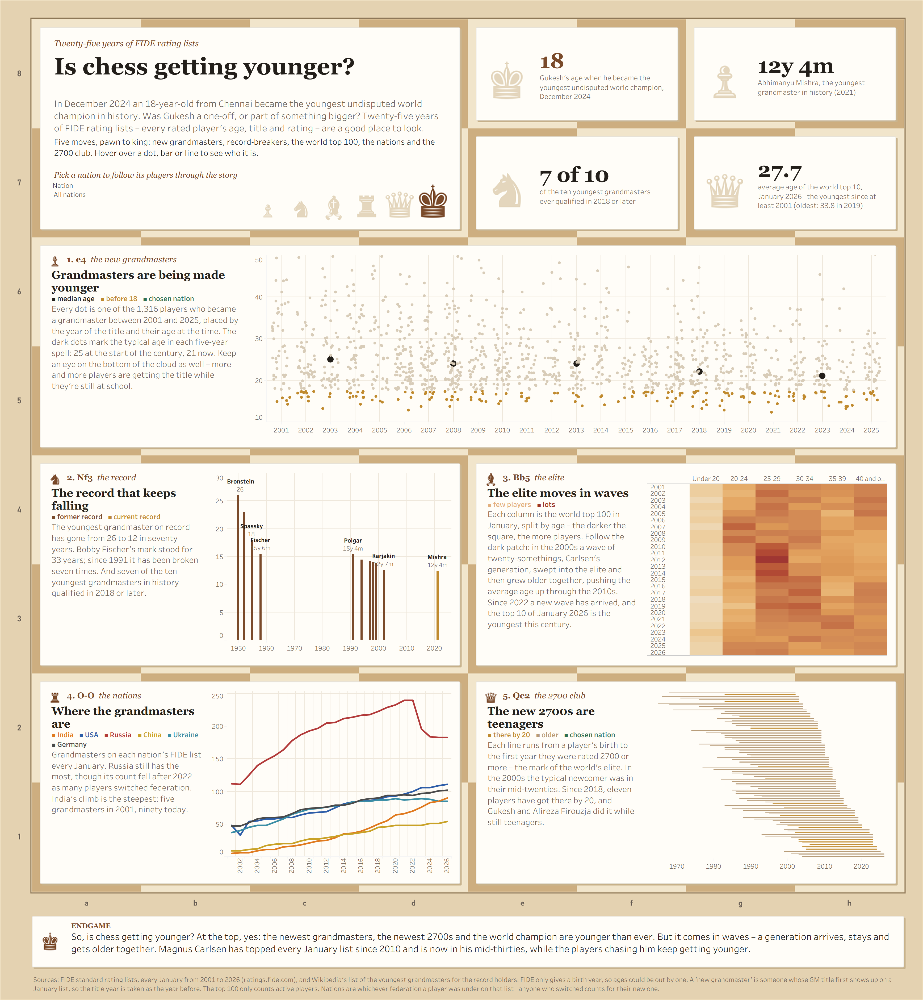

# Tableau portfolio

Three Tableau dashboards on sport, each built from data I collected and cleaned myself.

| | Question | Data | Shape |
|---|---|---|---|
| [chess](chess/) | Is chess getting younger? | FIDE rating lists, every January 2001-2026 | square, laid out on a chessboard |
| [running](running/) | What did super shoes do to marathon running? | World Athletics season top lists, 2001-2025 | long scroll, a marathon down the page |
| [ski-jumping](ski-jumping/) | Who rules the skies? | FIS World Cup results, 2001-2025 | landscape |



## How they're built

Each folder has the same steps:

1. `scripts/` - download or scrape the raw data, clean it, and shape it into the CSVs Tableau reads (`data/tableau`)
2. `scripts/text.py` - the commentary. The dashboards switch it with the same parameter as the charts (men/women, or
   the chosen nation for chess)
3. `tableau/build.py` - writes the workbook (`.twb`) and draws the background graphics with Pillow

`tableau_tools/twb.py` is a small helper for writing Tableau's workbook XML, and `gfx.py` holds the shared drawing bits.

To rebuild one:

```
pip install pandas requests beautifulsoup4 pillow pyarrow
python chess/scripts/download_fide.py
python chess/scripts/parse_fide.py
python chess/scripts/prepare_tableau.py
python chess/scripts/text.py
python chess/tableau/build.py
```

The raw downloads aren't in the repo (the FIDE lists alone are over 100 MB). Running the scripts fetches them again.
